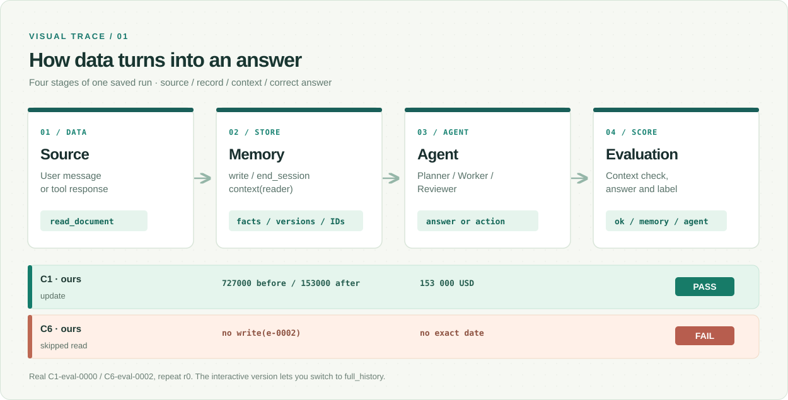

# Memory for a multi-agent system

The project compares the structured memory `ours` with four simple approaches to storing context. In synthetic projects, a Planner plans the work, a Worker uses tools, and a Reviewer checks the result. The job of memory is to pass current facts and constraints between sessions, without exposing other agents' drafts and without turning data from documents into instructions.

The repository contains the code of the memory systems, a scenario generator, tests, and the results of two kinds of checks:

- **Memory level (no LLM):** checks the content of the context on all scenarios.
- **Live layer (with LLM):** checks the answers and actions of the agents on a smaller sample.

The results of these checks must not be compared with each other. The key numbers and limitations are in the [short results overview](docs/RESULTS.md); the full analysis is in [`REPORT.md`](REPORT.md). The documentation map is in [`docs/README.md`](docs/README.md). To see the mechanics on a real scenario, start with the [end-to-end example](docs/WALKTHROUGH.md).

## How memory works — on one example



**[Step-by-step interactive demo](docs/demo/README.md)** opens locally without an API key: three real checkpoints, a switch between `ours` and `full_history`, and answers and actions from the saved traces. On GitHub the image above is available without JavaScript. The full conditions and data sources are in the [demo description](docs/demo/README.md).

## Quick start

For tests you can use Docker; run the commands from the repository root:

```bash
make docker-test       # Python tests, no model needed
make docker-reproduce  # recompute the memory level and tables; overwrites results/
```

To run without Docker you need Python 3.11+, then `make venv` and `make test`. If Python 3.11+ is available on the host, `make docs-check` checks links, numbers and checksums of the source artifacts without installing the project's dependencies. Building the Docker image may require network access; the checks after installation do not call the model.

**Recompute the results:** `make reproduce` or `make docker-reproduce` do not call the model, but they **overwrite** the files in `results/` (Docker mounts this directory from the current folder). Run them in a [separate Git working copy](docs/RUNBOOK.md#safe-recalculation-in-a-separate-working-copy); if you only need to check the numbers, `make docs-check` is enough.

To run a new **paid** agent run you need Node.js 18+ and Claude Code 2.1.316 (or the project's Docker image):

```bash
npm install -g @anthropic-ai/claude-code@2.1.316  # only without Docker
make doctor
make live  # by default writes to results/live/rerun
# or: ANTHROPIC_API_KEY=... make docker-live
```

Authorization: `ANTHROPIC_API_KEY`, `CLAUDE_CODE_OAUTH_TOKEN` (via `claude setup-token`), or interactive sign-in with `claude`. A short run with a subscription token has been verified; with an API key it has not. Secrets are not written to the results. The real conditions and limitations of the verified Docker run are in the [runbook](docs/RUNBOOK.md#verified-docker-conditions).

The sources of the numbers are in the [evidence map](docs/EVIDENCE.md). The difference between **55/66**, **124/156** and **778/780** is explained in [the metrics section](docs/PROBLEM.md#how-to-read-the-denominators); known defects are in the [register](docs/KNOWN_ISSUES.md).

## How to read the results

| Question | Where to look |
|---|---|
| Did memory help, and under which conditions? | [`docs/RESULTS.md`](docs/RESULTS.md); details — [`REPORT.md`](REPORT.md), sections 5–9 |
| What changed in the later iterations? | [`REPORT.md`](REPORT.md), sections 11–15 (*post hoc* checks) |
| What counts as success or failure? | [`docs/PROBLEM.md`](docs/PROBLEM.md), [`docs/SCENARIO_FORMAT.md`](docs/SCENARIO_FORMAT.md) |
| How is the implementation built? | [`docs/ARCHITECTURE.md`](docs/ARCHITECTURE.md) |
| How do I verify the numbers and where they come from? | [`docs/EVIDENCE.md`](docs/EVIDENCE.md) |
| Where are the known problems? | [`docs/KNOWN_ISSUES.md`](docs/KNOWN_ISSUES.md) |
| Why does the evaluator write `agent` when the answer is wrong? | [C6 failure walkthrough](docs/FAILURE_WALKTHROUGH.md) |
| How do I add my own memory? | [Extension guide](docs/EXTENDING.md) |
| How do `ours`–`ours4` differ? | [Version register](docs/EXPERIMENT_VERSIONS.md) |
| How do I recompute the tables and find a trace? | [`docs/RUNBOOK.md`](docs/RUNBOOK.md) |

**Important:** `eval` was used for the main results; `dev` for tuning; `holdout/` shows separate hard scenarios. Repeated tuning and external comparisons made after the benchmark was frozen do not replace the main result. The main live run is small; its differences of a few checks may lie within the spread.

## Repository structure

| Path | Contents |
|---|---|
| [`src/mam/`](src/mam/) | project code: memory, generator, evaluator, agents and runner |
| [`src/mam/systems/`](src/mam/systems/) | memory implementations: [`ours`](src/mam/systems/ours.py), [baseline systems](src/mam/systems/baselines.py), [summary](src/mam/systems/summary.py), [interface](src/mam/systems/base.py) |
| [`src/mam/generate.py`](src/mam/generate.py), [`validate.py`](src/mam/validate.py) | scenario generator and its validation |
| [`src/mam/simulate.py`](src/mam/simulate.py), [`scoring.py`](src/mam/scoring.py) | tool simulator and evaluation of context and actions |
| [`src/mam/live.py`](src/mam/live.py), [`agents.py`](src/mam/agents.py) | live session protocol and agent prompts |
| [`src/mam/llm.py`](src/mam/llm.py) | wrapper over the Claude CLI and a test client |
| [`tests/`](tests/) | acceptance and unit tests |
| [`scripts/`](scripts/) | documentation checks, tables and additional analyses |
| [`data/dev/`](data/dev/), [`data/eval/`](data/eval/), [`holdout/`](holdout/) | scenarios and reference answers |
| [`results/memory_level/`](results/memory_level/) | context evaluations and tables |
| [`results/live/`](results/live/) | agent runs, traces and tables |
| [`results/extraction/`](results/extraction/), [`results/pilot/`](results/pilot/) | extraction cache and model call measurements |
| [`results/post_hoc/`](results/post_hoc/) | additional checks and iterations after the freeze |
| [`docs/`](docs/) | specification, architecture, assumptions and decision log |

## License

[MIT](LICENSE).
