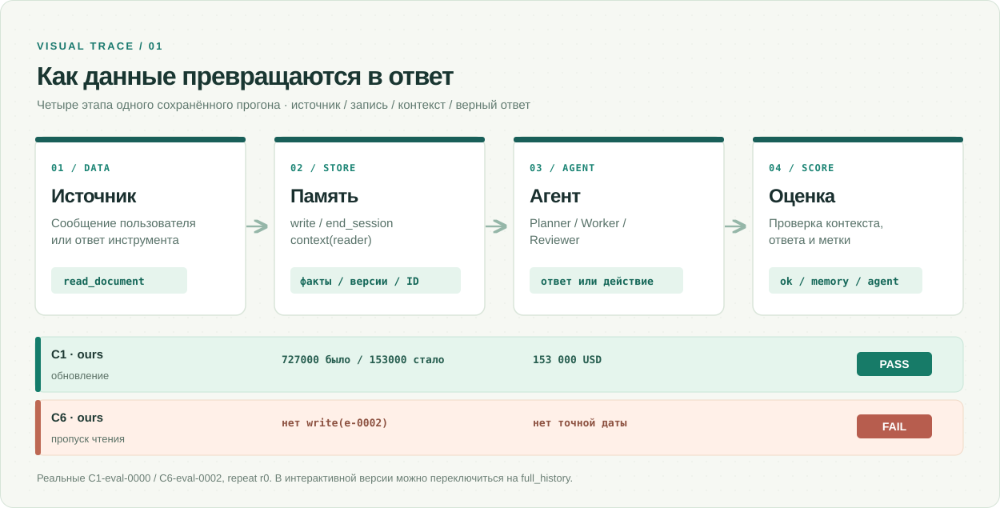

# Память для мультиагентной системы

Проект сравнивает структурированную память `ours` с четырьмя простыми подходами к хранению контекста. В синтетических проектах Planner планирует работу, Worker использует инструменты, Reviewer проверяет результат. Задача памяти — передавать между сессиями актуальные факты и ограничения, не раскрывая чужие черновики и не превращая данные из документов в инструкции.

В репозитории есть код систем памяти, генератор сценариев, тесты и результаты двух видов проверок:

- **Уровень памяти (без LLM):** проверяет содержимое контекста на всех сценариях.
- **Живой слой (с LLM):** проверяет ответы и действия агентов на меньшей выборке.

Результаты этих проверок нельзя приравнивать друг к другу. Ключевые цифры и ограничения — в [кратком обзоре результатов](docs/RESULTS.md); полный разбор — в [`REPORT.md`](REPORT.md). Карта документации — в [`docs/README.md`](docs/README.md). Чтобы увидеть механику на реальном сценарии, начните со [сквозного примера](docs/WALKTHROUGH.md).

## Как работает память — на одном примере



**[Пошаговое интерактивное демо](docs/demo/README.md)** открывается локально без API-ключа: три реальные контрольные точки, переключатель `ours` / `full_history`, ответы и действия из сохранённых трасс. На GitHub изображение выше доступно без JavaScript. Полные условия и источники данных — в [описании демо](docs/demo/README.md).

## Быстрый старт

Для тестов можно использовать Docker; команды выполняются из корня репозитория:

```bash
make docker-test       # тесты Python, модель не нужна
make docker-reproduce  # пересчитать уровень памяти и таблицы; перезаписывает results/
```

Для запуска без Docker нужны Python 3.11+, `make venv`, затем `make test`. При наличии Python 3.11+ на хосте команда `make docs-check` проверяет ссылки, числа и контрольные суммы исходных артефактов без установки зависимостей проекта. Сборка Docker-образа может потребовать сеть; проверки после установки не вызывают модель.

**Пересчитать результаты:** `make reproduce` или `make docker-reproduce` не вызывают модель, но **перезаписывают** файлы в `results/` (Docker монтирует этот каталог из текущей папки). Запускайте их в [отдельной рабочей копии Git](docs/RUNBOOK.md#безопасный-пересчёт-в-отдельной-рабочей-копии); если нужно только проверить числа, достаточно `make docs-check`.

Для нового **платного** прогона агентов требуются Node.js 18+ и Claude Code 2.1.316 (или Docker-образ проекта):

```bash
npm install -g @anthropic-ai/claude-code@2.1.316  # только без Docker
make doctor
make live  # по умолчанию пишет в results/live/rerun
# или: ANTHROPIC_API_KEY=... make docker-live
```

Авторизация: `ANTHROPIC_API_KEY`, `CLAUDE_CODE_OAUTH_TOKEN` (через `claude setup-token`) или интерактивный вход `claude`. Короткий запуск с токеном подписки проверен, по API-ключу — нет. Секреты не записываются в результаты. Реальные условия и ограничения проверенного Docker-прогона — в [руководстве](docs/RUNBOOK.md#проверенные-условия-docker).

Источники цифр — в [карте доказательств](docs/EVIDENCE.md), различие **55/66**, **124/156** и **778/780** — в [объяснении метрик](docs/PROBLEM.md#как-читать-знаменатели), известные дефекты — в [реестре](docs/KNOWN_ISSUES.md).

## Как читать результаты

| Вопрос | Где смотреть |
|---|---|
| Помогла ли память и при каких условиях? | [`docs/RESULTS.md`](docs/RESULTS.md); подробно — [`REPORT.md`](REPORT.md), разделы 5–9 |
| Что изменилось в последующих итерациях? | [`REPORT.md`](REPORT.md), разделы 11–15 (проверки *post hoc*) |
| Что считается успехом или провалом? | [`docs/PROBLEM.md`](docs/PROBLEM.md), [`docs/SCENARIO_FORMAT.md`](docs/SCENARIO_FORMAT.md) |
| Как устроена реализация? | [`docs/ARCHITECTURE.md`](docs/ARCHITECTURE.md) |
| Как проверить числа и их происхождение? | [`docs/EVIDENCE.md`](docs/EVIDENCE.md) |
| Как посмотреть известные проблемы? | [`docs/KNOWN_ISSUES.md`](docs/KNOWN_ISSUES.md) |
| Почему оценщик пишет `agent`, если ответ неверен? | [Разбор провала C6](docs/FAILURE_WALKTHROUGH.md) |
| Как добавить собственную память? | [Руководство по расширению](docs/EXTENDING.md) |
| Чем отличаются версии `ours`–`ours4`? | [Реестр версий](docs/EXPERIMENT_VERSIONS.md) |
| Как пересчитать таблицы и найти трассу? | [`docs/RUNBOOK.md`](docs/RUNBOOK.md) |

**Важно:** `eval` использовался для основных результатов; `dev` — для настройки; `holdout/` показывает отдельные трудные сценарии. Повторные настройки и внешние сравнения, выполненные после заморозки бенчмарка, не заменяют основной результат. Основной живой прогон мал; его отличия в несколько проверок могут лежать в пределах разброса.

## Структура репозитория

| Путь | Содержимое |
|---|---|
| [`src/mam/`](src/mam/) | код проекта: память, генератор, оценщик, агенты и раннер |
| [`src/mam/systems/`](src/mam/systems/) | реализации памяти: [`ours`](src/mam/systems/ours.py), [базовые системы](src/mam/systems/baselines.py), [резюме](src/mam/systems/summary.py), [интерфейс](src/mam/systems/base.py) |
| [`src/mam/generate.py`](src/mam/generate.py), [`validate.py`](src/mam/validate.py) | генератор сценариев и их проверка |
| [`src/mam/simulate.py`](src/mam/simulate.py), [`scoring.py`](src/mam/scoring.py) | симулятор инструментов и оценка контекста и действий |
| [`src/mam/live.py`](src/mam/live.py), [`agents.py`](src/mam/agents.py) | живой протокол сессии и промпты агентов |
| [`src/mam/llm.py`](src/mam/llm.py) | обёртка над Claude CLI и тестовый клиент |
| [`tests/`](tests/) | приёмочные и модульные тесты |
| [`scripts/`](scripts/) | проверки документации, таблицы и дополнительные анализы |
| [`data/dev/`](data/dev/), [`data/eval/`](data/eval/), [`holdout/`](holdout/) | сценарии и эталонные ответы |
| [`results/memory_level/`](results/memory_level/) | оценки контекста и таблицы |
| [`results/live/`](results/live/) | прогоны с агентами, трассы и таблицы |
| [`results/extraction/`](results/extraction/), [`results/pilot/`](results/pilot/) | кеш извлечения и измерения вызовов модели |
| [`results/post_hoc/`](results/post_hoc/) | дополнительные проверки и итерации после заморозки |
| [`docs/`](docs/) | спецификация, архитектура, допущения и журнал решений |

## Подкаталоги и границы системы

- `src`: [`src/README.md`](src/README.md) — корень исходного кода; содержит только пакет `mam` ([`src/mam/README.md`](src/mam/README.md)) и реализации памяти ([`src/mam/systems/README.md`](src/mam/systems/README.md)).
- `scripts`: [`scripts/README.md`](scripts/README.md) — отдельные утилиты: проверки документации и замороженных артефактов, сборка демо, анализы `post_hoc_*`.
- `external`: [`external/README.md`](external/README.md) — адаптеры внешних систем памяти (Mem0, Graphiti) и их запуск; проект не импортирует этот каталог.
- `docs`: [`docs/README.md`](docs/README.md) — документация и [интерактивное демо](docs/demo/README.md).
- `tests`: тесты `tests/acceptance` и `tests/unit` (без собственного контракта); запускаются через `pytest`.
- `data`, `holdout`, `results`: только данные (сценарии, эталоны, результаты прогонов); кода нет. `make dataset` перегенерирует `data/dev`, `data/eval` и `holdout/`.
- `.github`: [`.github/workflows/docs.yml`](.github/workflows/docs.yml) запускает `make docs-check` при каждом push и pull request (`fetch-depth: 0`).
- `Dockerfile`, `.dockerignore`: образ копирует `pyproject.toml`, `Makefile`, `LICENSE`, `src`, `tests`, `docs`, `data`, `holdout`, `results` (без `scripts/` и `external/`), поэтому `make docs-check` внутри образа не работает.

## Глобальные инварианты

- Скрипты `scripts/post_hoc_*.py` не меняют `src/mam`: варианты систем подставляются в процессе заменой `mam.live.create` / `memory_eval.make_system` ([`scripts/README.md`](scripts/README.md)).
- `make docs-check` проверяет: ссылки, якоря и цели `make` (`scripts/check_docs.py`), контрольные суммы артефактов (`scripts/check_frozen_artifacts.py`), замороженные итоги (`scripts/evidence_summary.py --verify`) и актуальность демо (`scripts/build_visual_demo.py --check`).
- `docs/demo/data.js` генерируется `scripts/build_visual_demo.py` и не редактируется вручную.
- Проект не импортирует `external/`.

## Глобальные побочные эффекты

- Вызовы модели (через `ClaudeCliClient`): `make live`, `make docker-live`, `make smoke` (лимит `--max-cost-usd 3`), `make extraction-trial` (лимит 3 USD), `make extraction` (`MAX_COST`, по умолчанию 10), `make doctor` (один пробный вызов), а также подкоманды `scripts/post_hoc_*.py` и `external/run.py`.
- Запись файлов: `make reproduce` и `make docker-reproduce` перезаписывают `results/`; `make memory-level` пишет в `results/memory_level/<split>`; `make live-tables`; `make live` — по умолчанию в `results/live/rerun`; `make smoke` — в `results/live/smoke_check`; `make extraction*` — в `results/extraction/...`; `make mutation` — в `mutants/`; `make venv` — в `.venv`; `scripts/post_hoc_*.py` — в `results/post_hoc/`; `external/run.py` — в `results/post_hoc/external/`.
- `scripts/build_visual_demo.py` пишет `docs/demo/data.js`, если не задан `--check`.

## Проверка системы

- Запуск: `make test` (`$(PY) -m pytest`, `PY ?= .venv/bin/python`, поэтому нужен `make venv`); также `make test-generator` и `make docker-test`. Проверка документации и чисел без LLM — `make docs-check`.
- Тесты в `scripts/` (`test_post_hoc_*.py`) и `external/` (smoke-тесты) не входят в `make test` (`testpaths = ["tests"]`).

## Лицензия

[MIT](LICENSE).
