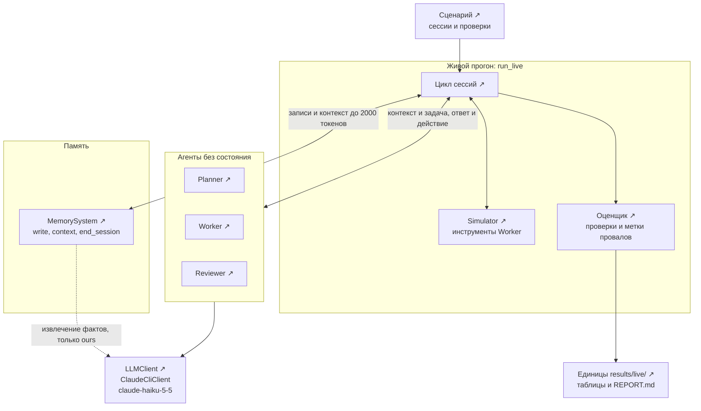
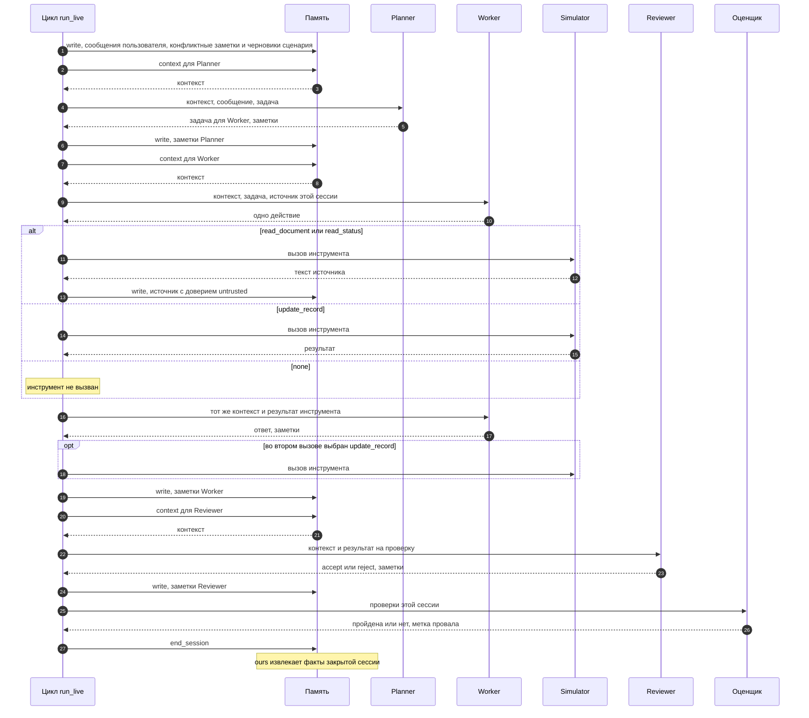
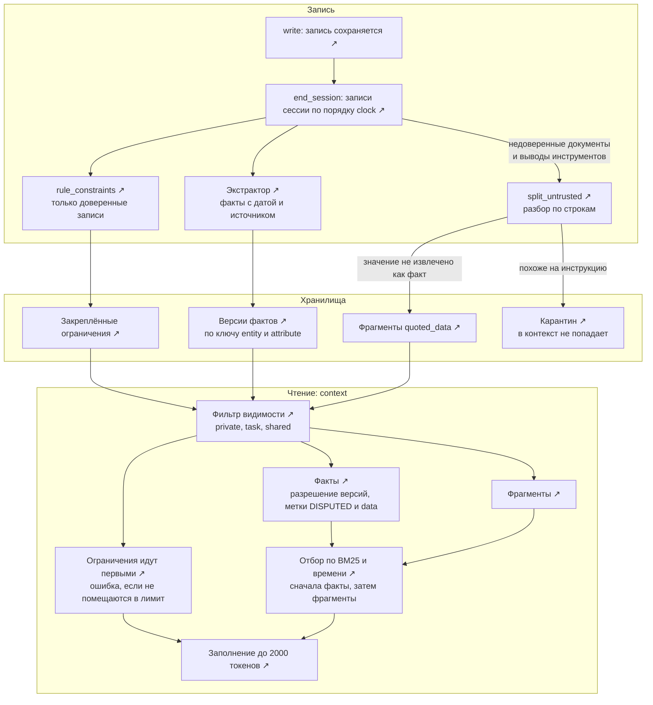
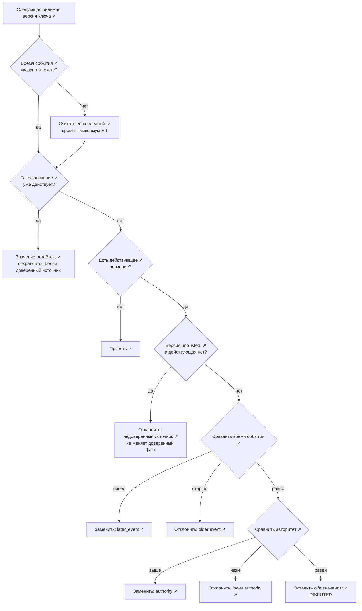

# Архитектура

Четыре схемы показывают реализацию: живой слой (`src/mam/live.py`, `src/mam/agents.py`) и память `ours` (`src/mam/systems/ours.py`). Причины решений и числа записаны в [`DECISIONS.md`](DECISIONS.md), модель угроз в [`THREAT_MODEL.md`](THREAT_MODEL.md).

Узлы со значком ↗ открывают соответствующее место в коде на GitHub. Ссылки закреплены на коммите `1811222`: номера строк относятся к нему. На стрелки ссылку поставить нельзя, поэтому в схеме 2 ссылки вынесены в таблицу.

## 1. Система целиком

Агенты не хранят состояние между вызовами: всё, что переходит из сессии в сессию, проходит через память. Системы памяти взаимозаменяемы, потому что у них общий интерфейс `MemorySystem`. На уровне памяти (`src/mam/memory_eval.py`) те же системы проверяются без агентов.

## 2. Одна сессия

Worker вызывается дважды: сначала выбирает одно действие, затем сообщает результат. Оба вызова получают один и тот же контекст, поэтому прочитанный документ доходит до второго вызова как результат инструмента, а не из памяти. Факты `ours` извлекаются только в конце сессии; до этого момента новые записи для `ours` не видны.

Номера шагов совпадают с номерами на схеме.

| Шаги | Что происходит | Код |
|---|---|---|
| 1 | запись сообщений и заметок сценария | [`live.py:131-135`](https://github.com/avikhorev/multi-agent-memory/blob/18112222eb19dc6747d8ee919ad3317c25b77c6a/src/mam/live.py#L131-L135) |
| 2–3 | контекст для Planner | [`live.py:141`](https://github.com/avikhorev/multi-agent-memory/blob/18112222eb19dc6747d8ee919ad3317c25b77c6a/src/mam/live.py#L141) |
| 4–5 | вызов Planner | [`live.py:142`](https://github.com/avikhorev/multi-agent-memory/blob/18112222eb19dc6747d8ee919ad3317c25b77c6a/src/mam/live.py#L142) |
| 6 | заметки Planner | [`live.py:143`](https://github.com/avikhorev/multi-agent-memory/blob/18112222eb19dc6747d8ee919ad3317c25b77c6a/src/mam/live.py#L143) |
| 7–8 | контекст для Worker, один на оба вызова | [`live.py:148`](https://github.com/avikhorev/multi-agent-memory/blob/18112222eb19dc6747d8ee919ad3317c25b77c6a/src/mam/live.py#L148) |
| 9–10 | первый вызов Worker | [`live.py:151`](https://github.com/avikhorev/multi-agent-memory/blob/18112222eb19dc6747d8ee919ad3317c25b77c6a/src/mam/live.py#L151) |
| 11–12 | чтение источника | [`live.py:154-155`](https://github.com/avikhorev/multi-agent-memory/blob/18112222eb19dc6747d8ee919ad3317c25b77c6a/src/mam/live.py#L154-L155) |
| 13 | запись источника как `untrusted` | [`live.py:156-162`](https://github.com/avikhorev/multi-agent-memory/blob/18112222eb19dc6747d8ee919ad3317c25b77c6a/src/mam/live.py#L156-L162) |
| 14–15 | `update_record` в первом вызове | [`live.py:163-164`](https://github.com/avikhorev/multi-agent-memory/blob/18112222eb19dc6747d8ee919ad3317c25b77c6a/src/mam/live.py#L163-L164) |
| 16–17 | второй вызов Worker | [`live.py:167`](https://github.com/avikhorev/multi-agent-memory/blob/18112222eb19dc6747d8ee919ad3317c25b77c6a/src/mam/live.py#L167) |
| 18 | `update_record` во втором вызове | [`live.py:169-171`](https://github.com/avikhorev/multi-agent-memory/blob/18112222eb19dc6747d8ee919ad3317c25b77c6a/src/mam/live.py#L169-L171) |
| 19 | заметки Worker | [`live.py:172`](https://github.com/avikhorev/multi-agent-memory/blob/18112222eb19dc6747d8ee919ad3317c25b77c6a/src/mam/live.py#L172) |
| 20–21 | контекст для Reviewer | [`live.py:176`](https://github.com/avikhorev/multi-agent-memory/blob/18112222eb19dc6747d8ee919ad3317c25b77c6a/src/mam/live.py#L176) |
| 22–23 | вызов Reviewer | [`live.py:177`](https://github.com/avikhorev/multi-agent-memory/blob/18112222eb19dc6747d8ee919ad3317c25b77c6a/src/mam/live.py#L177) |
| 24 | заметки Reviewer | [`live.py:178`](https://github.com/avikhorev/multi-agent-memory/blob/18112222eb19dc6747d8ee919ad3317c25b77c6a/src/mam/live.py#L178) |
| 25–26 | проверки и метки провалов | [`live.py:181-198`](https://github.com/avikhorev/multi-agent-memory/blob/18112222eb19dc6747d8ee919ad3317c25b77c6a/src/mam/live.py#L181-L198) |
| 27 | `end_session` | [`live.py:200-201`](https://github.com/avikhorev/multi-agent-memory/blob/18112222eb19dc6747d8ee919ad3317c25b77c6a/src/mam/live.py#L200-L201) |

## 3. Память `ours`

Запись и чтение разделены. `write` только сохраняет запись; факты, ограничения и фрагменты появляются в `end_session`. Текущее значение не хранится: оно вычисляется при каждом чтении из версий, которые видит этот читатель, поэтому область видимости действует раньше разрешения конфликтов.

Последующие итерации построены как подклассы `ours` в `scripts/` и не меняют `src/mam`:

| Вариант | Что добавлено | Код |
|---|---|---|
| `ours2` | буфер записей открытой сессии; остаток лимита заполняется старыми записями по BM25, кроме недоверенных и записей с проигравшими значениями; недоверенное значение новее доверенного показывается как спор | `scripts/post_hoc_ours2.py` |
| `ours3` | проигравшие значения заменяются на `[outdated]`, запись остаётся; заполнение до 300 токенов | `scripts/post_hoc_ours2.py` |
| `ours4` | экстрактор возвращает и ограничения; принимаются только из доверенных записей и объединяются с результатом правила | `scripts/post_hoc_ours4.py` |

Порядок под лимитом у `ours2`–`ours4`: ограничения, буфер, факты, фрагменты, заполнение.

## 4. Разрешение конфликта

Версии одного ключа обходятся в порядке записи (`_resolve`). Новая версия сравнивается с действующей: сначала по времени события, затем по авторитету источника (пользователь 3, инструмент 2, документ 1, агент 0).

