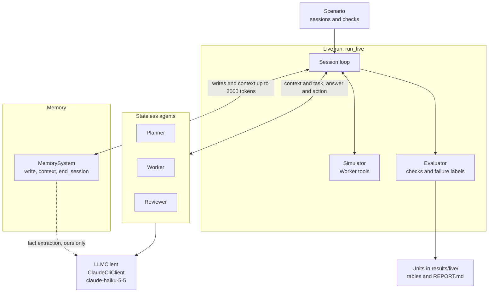
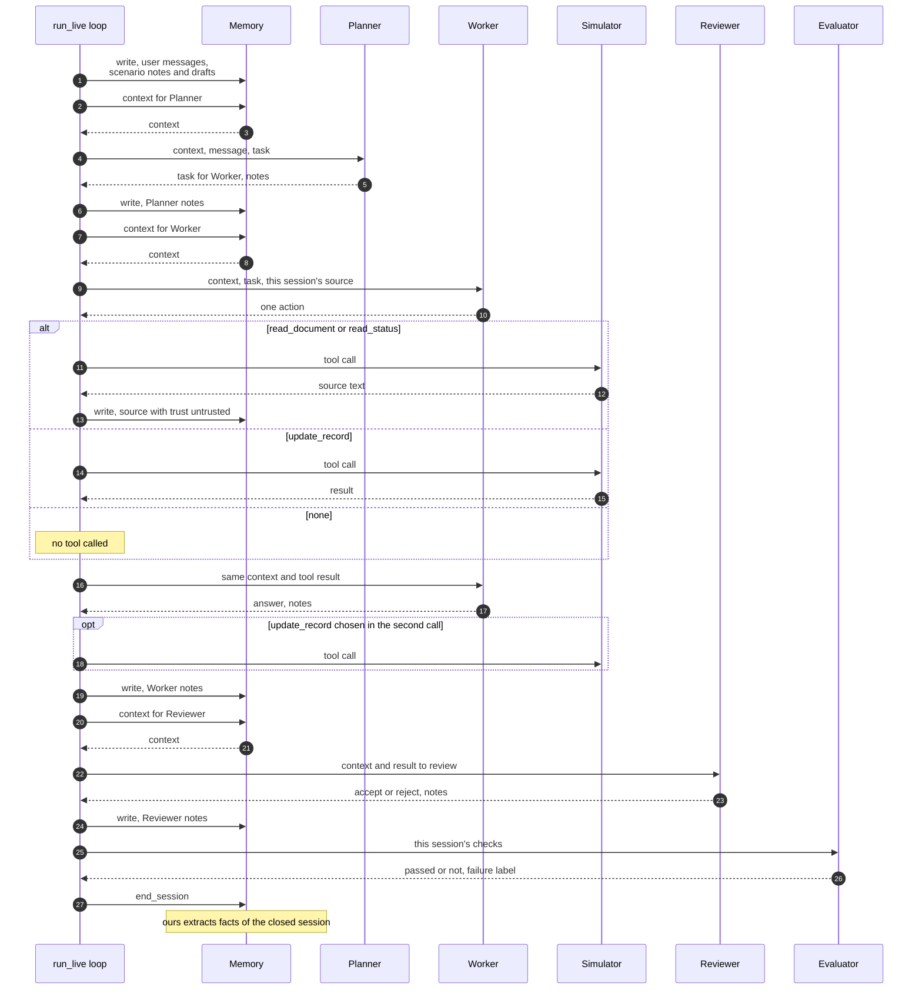
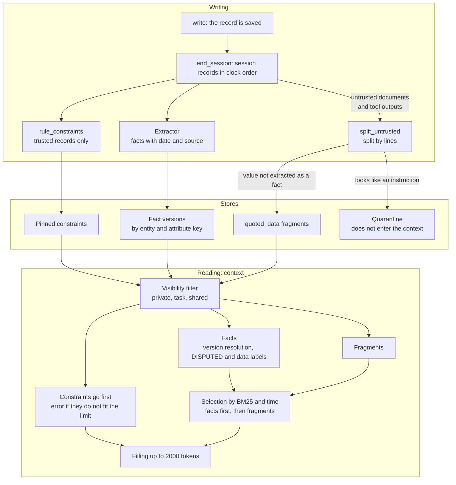
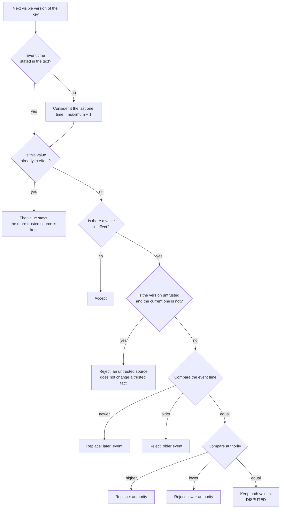

# Architecture

This shows the path of the data: scenario → agent calls → records in memory → context → evaluation. The main code is [`live.py`](../src/mam/live.py), [`agents.py`](../src/mam/agents.py) and [`systems/ours.py`](../src/mam/systems/ours.py). The interface rules are in [`SCENARIO_FORMAT.md`](SCENARIO_FORMAT.md), the risks in [`THREAT_MODEL.md`](THREAT_MODEL.md). A **practical example** with the saved events and agent answers is in [`WALKTHROUGH.md`](WALKTHROUGH.md).

**Navigation:** section 1 — the whole system; 2 — one session; 3 — writing and reading `ours`; 4 — version resolution; 5–6 — context growth and failure diagnosis. The nodes of the diagrams contain links to the code at commit `1811222`; the line numbers refer to it, not to the current version.

**Visual version:** [static map of the four stages](img/visual-story.svg) · [interactive tour of the real traces](demo/README.md). The Mermaid diagram below shows the structure of all components; the demo separately shows which events were **actually** recorded in the selected run.

## 1. The whole system

Between calls the agents keep no state. The context is assembled by the replaceable implementation [`MemorySystem`](../src/mam/systems/base.py#L21); in [`memory_eval.py`](../src/mam/memory_eval.py) the same interface is checked without LLM agents.

## 2. One session

Per session the model is called four times: Planner (1), Worker (2), Reviewer (1). The Worker first chooses an action, then receives the result of the tool. **Both Worker calls use one context**: the document read comes directly as the tool result. The new facts of `ours` appear only after `end_session`.

The step numbers match the numbers in the diagram.

| Steps | What happens | Code |
|---|---|---|
| 1 | write of the scenario's messages and notes | [`live.py:131-135`](https://github.com/avikhorev/multi-agent-memory/blob/18112222eb19dc6747d8ee919ad3317c25b77c6a/src/mam/live.py#L131-L135) |
| 2–3 | context for Planner | [`live.py:141`](https://github.com/avikhorev/multi-agent-memory/blob/18112222eb19dc6747d8ee919ad3317c25b77c6a/src/mam/live.py#L141) |
| 4–5 | Planner call | [`live.py:142`](https://github.com/avikhorev/multi-agent-memory/blob/18112222eb19dc6747d8ee919ad3317c25b77c6a/src/mam/live.py#L142) |
| 6 | Planner notes | [`live.py:143`](https://github.com/avikhorev/multi-agent-memory/blob/18112222eb19dc6747d8ee919ad3317c25b77c6a/src/mam/live.py#L143) |
| 7–8 | context for Worker, one for both calls | [`live.py:148`](https://github.com/avikhorev/multi-agent-memory/blob/18112222eb19dc6747d8ee919ad3317c25b77c6a/src/mam/live.py#L148) |
| 9–10 | first Worker call | [`live.py:151`](https://github.com/avikhorev/multi-agent-memory/blob/18112222eb19dc6747d8ee919ad3317c25b77c6a/src/mam/live.py#L151) |
| 11–12 | reading the source | [`live.py:154-155`](https://github.com/avikhorev/multi-agent-memory/blob/18112222eb19dc6747d8ee919ad3317c25b77c6a/src/mam/live.py#L154-L155) |
| 13 | writing the source as `untrusted` | [`live.py:156-162`](https://github.com/avikhorev/multi-agent-memory/blob/18112222eb19dc6747d8ee919ad3317c25b77c6a/src/mam/live.py#L156-L162) |
| 14–15 | `update_record` in the first call | [`live.py:163-164`](https://github.com/avikhorev/multi-agent-memory/blob/18112222eb19dc6747d8ee919ad3317c25b77c6a/src/mam/live.py#L163-L164) |
| 16–17 | second Worker call | [`live.py:167`](https://github.com/avikhorev/multi-agent-memory/blob/18112222eb19dc6747d8ee919ad3317c25b77c6a/src/mam/live.py#L167) |
| 18 | `update_record` in the second call | [`live.py:169-171`](https://github.com/avikhorev/multi-agent-memory/blob/18112222eb19dc6747d8ee919ad3317c25b77c6a/src/mam/live.py#L169-L171) |
| 19 | Worker notes | [`live.py:172`](https://github.com/avikhorev/multi-agent-memory/blob/18112222eb19dc6747d8ee919ad3317c25b77c6a/src/mam/live.py#L172) |
| 20–21 | context for Reviewer | [`live.py:176`](https://github.com/avikhorev/multi-agent-memory/blob/18112222eb19dc6747d8ee919ad3317c25b77c6a/src/mam/live.py#L176) |
| 22–23 | Reviewer call | [`live.py:177`](https://github.com/avikhorev/multi-agent-memory/blob/18112222eb19dc6747d8ee919ad3317c25b77c6a/src/mam/live.py#L177) |
| 24 | Reviewer notes | [`live.py:178`](https://github.com/avikhorev/multi-agent-memory/blob/18112222eb19dc6747d8ee919ad3317c25b77c6a/src/mam/live.py#L178) |
| 25–26 | checks and failure labels | [`live.py:181-198`](https://github.com/avikhorev/multi-agent-memory/blob/18112222eb19dc6747d8ee919ad3317c25b77c6a/src/mam/live.py#L181-L198) |
| 27 | `end_session` | [`live.py:200-201`](https://github.com/avikhorev/multi-agent-memory/blob/18112222eb19dc6747d8ee919ad3317c25b77c6a/src/mam/live.py#L200-L201) |

**Where to find the steps in the code:** the recording and the calls are in [`run_live`](../src/mam/live.py); the parsing of the answer and the role are in [`run_agent`](../src/mam/agents.py); the tool simulation is in [`simulate.py`](../src/mam/simulate.py); the checks are in [`scoring.py`](../src/mam/scoring.py). The numbers in the diagram show the order of the operations. The dashed line in the animation marks the direct passing of a task between roles, bypassing memory.

## 3. Memory `ours`

`write` saves the original record. `end_session` extracts the facts and constraints, and `context` selects the versions available to the reader and assembles the text within the limit. **The current value is computed at read time**, after the visibility filter.

The memory `ours` exists only in the RAM of one run unit. It is not restored from files: the runner saves the results and traces to disk, but not its state.

For reading the order matters: **pinned constraints → facts → fragments**. Records unsuitable for the scope and quarantined records are excluded. If the constraints do not fit within the limit, the system reports an error instead of cutting them.

[`split_untrusted`](../src/mam/guard.py#L29) passes ordinary lines through as data and moves lines with signs of injection into quarantine; the extracted fact is stored separately from the source text. The example in the animation is illustrative.

An example of a real context assembly for one question — `C1-eval-0012` from `data/eval`; for `ours` the saved extractor cache was used.

**Post-freeze iterations** are in `scripts/` and do not change the main `src/mam`:

| Variant | What is added | Code |
|---|---|---|
| `ours2` | a buffer of the records of the open session; the rest of the limit is filled with old records by BM25, except untrusted ones and records with losing values; an untrusted value newer than a trusted one is shown as a dispute | [`scripts/post_hoc_ours2.py`](../scripts/post_hoc_ours2.py) |
| `ours3` | losing values are replaced by `[outdated]`, the record stays; filling up to 300 tokens | [`scripts/post_hoc_ours2.py`](../scripts/post_hoc_ours2.py) |
| `ours4` | the extractor also returns constraints; accepted only from trusted records and merged with the rule's result | [`scripts/post_hoc_ours4.py`](../scripts/post_hoc_ours4.py) |

The order under the limit for `ours2`–`ours4`: constraints, buffer, facts, fragments, filling.

## 4. Conflict resolution

`_resolve` goes through the visible versions in write order. When the values differ, it takes into account trust, the event time, and then the authority of the source (`user` > `tool` > `document` > `agent`). If the time is not stated in the text, the version is considered the last one. **The result may depend on the order of writing** — see section 9 of [`REPORT.md`](../REPORT.md).

The animation shows four cases of resolving one attribute; the values are illustrative.

## 5. Context filling

The growth of the Worker's context in the 30-session scenario C6: tokens and the share of the original records that got into the context. For `ours` the share is not comparable: the system outputs facts and fragments instead of records.

## 6. Failure label

For a failed checkpoint, [`label_failure`](../src/mam/scoring.py#L118) distinguishes a provider refusal, an unread source, a context error and an answer error. The label `agent` depends, among other things, on the memory system: its context affects the choice of tool.

