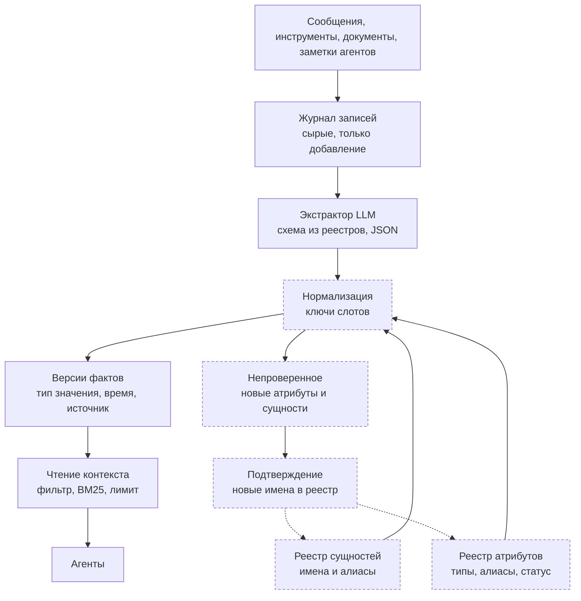

# Боевая работа: что есть и чего не хватает

**Статус: план, не реализовано.** Этот файл описывает, что нужно изменить, чтобы память работала с сущностями и атрибутами, которые заранее не известны. Текущее устройство описано в [`ARCHITECTURE.md`](ARCHITECTURE.md), известные ограничения — в [`KNOWN_ISSUES.md`](KNOWN_ISSUES.md), решение о статусе — в [D45](DECISIONS.md#d45). Текущий код и результаты эксперимента этим файлом не меняются.

## 1. Целевая схема

Пунктирные блоки — новые компоненты. Всё, что не пунктирное, есть в текущем коде.

На схеме не показаны закреплённые ограничения, переизвлечение фактов при смене схемы и метрики качества.

## 2. Разрывы в текущем коде

| Что | Где сейчас | Почему мешает в боевой работе |
|---|---|---|
| Закрытый список атрибутов | [`ATTRIBUTES`](../src/mam/extract.py#L191), производный от [`LABELS`](../src/mam/extract.py#L48); 12 имён | Новый параметр не попадёт в память |
| Отбрасывание неизвестного атрибута | [`LLMExtractor._extract`](../src/mam/extract.py#L288) | Факт пропадает без следа |
| Свободное имя сущности в правилах | [`extract.py#L122`](../src/mam/extract.py#L122) | Модуль берётся регулярным выражением из текста |
| Свободное имя сущности у LLM | [`extract.py#L292`](../src/mam/extract.py#L292) | `notifications` и `Notifications` дают два разных слота |
| Ключ слота из сырых строк | [`ours.py#L75`](../src/mam/systems/ours.py#L75), ключ `(entity, attribute)` | Одно поле под разными именами расщепляет версии (см. [D39](DECISIONS.md#d39)) |
| Значения строками | [`_norm`](../src/mam/systems/ours.py#L22) убирает регистр, пробелы и запятые | Нет типов: даты в разных форматах не равны, деньги не упорядочиваются |
| Время события — номер дня или `-1` | [`DAY_ZERO`](../src/mam/extract.py#L17), [`UNKNOWN_TIME`](../src/mam/extract.py#L18) | Нужна метка времени самого сообщения |
| Поля `valid_to` и `supersedes` | [`Fact`](../src/mam/types.py#L8) | Не используются при чтении |
| Версия схемы не хранится | нет поля в `Fact` | Факты нельзя переизвлечь после смены схемы |

Сейчас всё хранится в оперативной памяти одного прогона ([`ARCHITECTURE.md`](ARCHITECTURE.md)). Для боевой работы понадобится постоянное хранилище, но это отдельная задача.

## 3. Что проверить до изменений кода

1. **Набор сценариев с неизвестной схемой.** Новые атрибуты, новые сущности и перефразированные имена, которых нет в `LABELS`. Текущие сценарии построены по одному классу шаблонов ([`ASSUMPTIONS.md`](ASSUMPTIONS.md)), поэтому на них этого не видно.
2. **Метрики:**
   - точность и полнота по атрибутам и сущностям;
   - ложные слияния: две разные сущности стали одной;
   - ложные расщепления: одна сущность или слот разбились на два;
   - доля фактов, попавших в «Непроверенное».
3. **Стоимость извлечения на реальном объёме.** Не измерена. Цифры в [`RESULTS.md`](RESULTS.md) относятся к экспериментальным прогонам, а не к боевой нагрузке.

## 4. Что этим файлом не решено

- Конкурентная запись и несколько читателей одновременно ([`KNOWN_ISSUES.md`](KNOWN_ISSUES.md)).
- Постоянное хранилище вместо памяти процесса.
- Выбор модели извлечения и провайдера; RAG с эмбеддингами.
