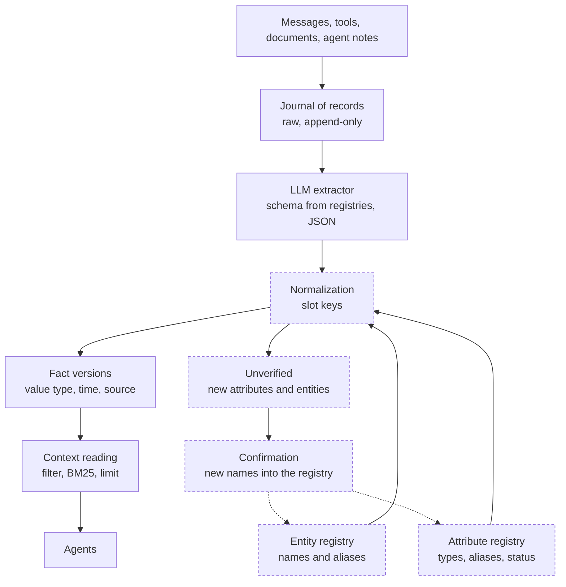

# Production work: what exists and what is missing

**Status: plan, not implemented.** This file describes what must change for the memory to work with entities and attributes that are not known in advance. The current structure is described in [`ARCHITECTURE.md`](ARCHITECTURE.md), the known limitations in [`KNOWN_ISSUES.md`](KNOWN_ISSUES.md), the decision on the status in [D45](DECISIONS.md#d45). The current code and the results of the experiment are not changed by this file.

## 1. Target design

Dashed blocks are new components. Everything that is not dashed already exists in the current code.

The diagram does not show the pinned constraints, the re-extraction of facts when the schema changes, and the quality metrics.

## 2. Gaps in the current code

| What | Where it is now | Why it gets in the way in production |
|---|---|---|
| A closed list of attributes | [`ATTRIBUTES`](../src/mam/extract.py#L191), derived from [`LABELS`](../src/mam/extract.py#L48); 12 names | A new parameter will not get into the memory |
| Discarding of an unknown attribute | [`LLMExtractor._extract`](../src/mam/extract.py#L288) | A fact disappears without a trace |
| A free entity name in the rules | [`extract.py#L122`](../src/mam/extract.py#L122) | The module is taken by a regular expression from the text |
| A free entity name in the LLM | [`extract.py#L292`](../src/mam/extract.py#L292) | `notifications` and `Notifications` give two different slots |
| The slot key from raw strings | [`ours.py#L75`](../src/mam/systems/ours.py#L75), key `(entity, attribute)` | One field under different names splits the versions (see [D39](DECISIONS.md#d39)) |
| Values as strings | [`_norm`](../src/mam/systems/ours.py#L22) removes case, spaces and commas | No types: dates in different formats are not equal, money is not ordered |
| Event time is a day number or `-1` | [`DAY_ZERO`](../src/mam/extract.py#L17), [`UNKNOWN_TIME`](../src/mam/extract.py#L18) | A timestamp of the message itself is needed |
| The fields `valid_to` and `supersedes` | [`Fact`](../src/mam/types.py#L8) | Not used when reading |
| The schema version is not stored | no field in `Fact` | Facts cannot be re-extracted after a schema change |
| Rules only by keywords | [`rule_constraints`](../src/mam/extract.py#L39), [`sentences`](../src/mam/extract.py#L35) | A wording without the keywords ("keep it internal") silently does not become a rule; "never discussed" becomes a false rule |

Right now everything is stored in the RAM of one run ([`ARCHITECTURE.md`](ARCHITECTURE.md)). Production work will need persistent storage, but that is a separate task.

## 3. What to check before changing the code

1. **A set of scenarios with an unknown schema.** New attributes, new entities and rephrased names that are not in `LABELS`. The current scenarios are built on one class of templates ([`ASSUMPTIONS.md`](ASSUMPTIONS.md)), so this is not visible on them.
2. **Metrics:**
   - precision and recall by attributes and entities;
   - false merges: two different entities became one;
   - false splits: one entity or slot was divided into two;
   - the share of facts that went into "Unverified";
   - missed rules (present in the text, absent from the context) and false rules (absent from the text, present in the context).
   A set for the rules: the same instruction in different wordings, without the keywords from the list, and neutral sentences with them ("never discussed", "from now on the sync is on Thursday").
3. **The cost of extraction at real volume.** Not measured. The figures in [`RESULTS.md`](RESULTS.md) refer to the experimental runs, not to the production load.

## 4. What this file does not solve

- Concurrent writing and several readers at the same time ([`KNOWN_ISSUES.md`](KNOWN_ISSUES.md)).
- Persistent storage instead of the memory of the process.
- The choice of the extraction model and the provider; RAG with embeddings.
