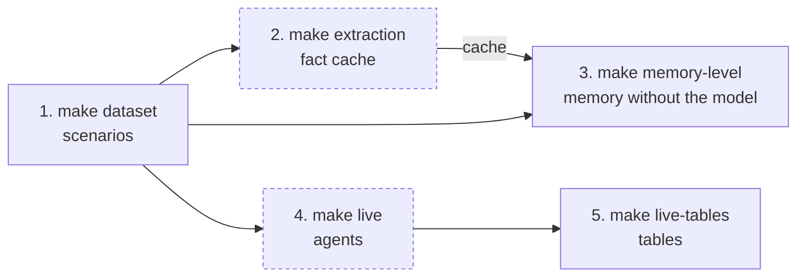

# Running and reproduction

All commands are run from the repository root. The main result is recorded in `results/live/main`; **new runs must not overwrite it**. To verify the published numbers you **do not need** to re-run the agents or overwrite any data.

## 1. Installation and tests

**Docker** (Python, Node.js and the pinned Claude Code inside the image):

```bash
make docker-test
```

`make docs-check` is run separately **on a host with Python 3.11+** (without Docker and LLM). Building the Docker image requires downloading dependencies on the first run. Tests and documentation checks do not call the LLM. For `make docker-reproduce`, first prepare a separate working copy (see below): the command mounts the current `results/` **for writing**.

**Locally** (Python 3.11+):

```bash
make venv
make test
make docs-check
```

For Python commands outside `make`, activate the virtual environment (`. .venv/bin/activate`) so that the project's dependencies are available. `make docs-check` uses the standard library and does not require activating the environment.

## Pipeline

The stages run in order. The paid ones are marked; steps 1, 3 and 5 do not call the model.



| Step | What it does | Paid | What it reads and what it creates |
|---|---|---|---|
| **1. `make dataset`** | Creates the scenarios: a project history of 10–30 sessions with facts and questions for the memory; each question has a reference answer. 361 files in total. Needed by all other steps. | No | Creates `data/dev`, `data/eval`, `holdout` |
| **2. `make extraction`** | The model reads each scenario record and writes out the facts: entity, attribute, value. The answers are saved to a cache, so that a re-run does not pay for them again. | Yes | Reads the scenarios; creates `results/extraction/<split>/cache.jsonl` |
| **3. `make memory-level`** | Runs the memory systems without the model: whether the needed facts are in the context and whether stale ones are absent. Uses the cache from step 2 if it exists. | No | Reads the scenarios and the cache; creates `results/memory_level/<split>/`, including `tables.md` |
| **4. `make live`** | Real agents Planner, Worker and Reviewer on Claude answer the scenario's questions, relying on memory. The main run cost about $6. | Yes | Reads the scenarios; creates the `results/live/<OUT>` directory with the traces |
| **5. `make live-tables`** | Builds a table from the results of the live run: which checks each memory system passed by categories C0–C6. | No | Reads the directory from step 4; creates `tables.md` next to it |

**Table** — the file `tables.md`: a summary in Markdown format with the shares of correct answers by category and memory system. **Cache** — saved model answers, so that a re-run does not pay for them again. The dashed frame marks a paid step.

Dependencies:
- All stages read the scenarios from step 1. The scenarios are deterministic: on Python 3.11–3.13 regeneration produces the same files, so after `make dataset` without changes `git diff --stat data holdout` must be empty.
- Step 3 uses the cache from step 2 if the file `results/extraction/<split>/cache.jsonl` exists. Without the cache, the variants with the cache will not appear in the tables.
- Step 5 reads the directory from step 4: the variable `DIR` defaults to `OUT`, that is `results/live/rerun`.
- The paid steps 2 and 4 first check access to the model (`make doctor`). Step 4 can be re-run after an interruption.

`make reproduce` runs step 3 on `eval` and `holdout`, and step 5 for `results/live/main` if the directory exists. It does not run steps 1, 2 and 4.

Short checks: `make extraction-trial` instead of step 2 and `make smoke` instead of step 4.

## Reproduction matrix

**First choose whether you want to check the saved data or create new data.** Checks and recalculation of tables do not call the model; the commands for a new live run and for extraction are paid. The historical cost is not a forecast of the current price.

| Goal | Command | LLM / cost | What will change | What to compare |
|---|---|---|---|---|
| Check the documentation, numbers and source artifacts | `make docs-check` | No; Python standard library | Nothing | Links and anchors, `make` targets, numbers E1/E2, SHA-256 of six groups |
| Check the key numbers against the JSON/JSONL | `python3 scripts/evidence_summary.py --verify` | No | Nothing | 780 checkpoints per system (memory), 156 (live layer); [E1/E2](EVIDENCE.md) |
| Check the code | `make test` | No | Only the test service files | **419** `pytest` tests in this version; the documentation tests are run **separately** in `docs-check` |
| Recalculate the memory and the saved summaries | `make reproduce` (in a separate copy) | No | **Will overwrite** `results/memory_level/{eval,holdout}/` and `results/live/main/tables.md` | `git diff --stat -- results`; acceptable discrepancies below |
| Rebuild only the live table | `make live-tables DIR=results/live/main` | No | **Will overwrite** the table in `DIR` | Source units in `DIR/units/`; [E2](EVIDENCE.md#e2) |
| Regenerate the synthetic scenarios | `make dataset` | No | **Will overwrite** `data/dev/`, `data/eval/`, `holdout/` | `git diff --stat data holdout` (Python 3.11–3.13) |
| New main live run | `make live` | **Yes, paid** | A new directory `OUT` (by default `results/live/rerun`) | Its own `OUT/units/` and `OUT/tables.md`; an exact match of the answers cannot be expected |
| New extraction pass | `make extraction` | **Yes, paid** | Files `results/extraction/{eval,holdout}/` | Only in a separate working copy, if you need to keep the reference caches |

For `make live` the historical run of variant A cost $6.275, the extraction pass — $3.415; this is a **fact of the past measurement**, not a budget or a promise of the price of a new run. The separate *post hoc* checks have their own procedures and sets in section 5. If you only need to check the conclusions of the report, a new paid run is **not needed**.

**Caution about resumption and parallelism:** `MAX_COST` is soft; on a re-run an early termination is possible, and with many simultaneous expensive units the limit may be exceeded. Details and workarounds are in the [known issues](KNOWN_ISSUES.md#budget-resume) and the [parallel budget](KNOWN_ISSUES.md#parallel-budget).

## Safe recalculation in a separate working copy

**Recommended order:** first check the archive **without changes**:

```bash
make docs-check
python3 scripts/check_frozen_artifacts.py
```

`docs-check` checks the links, the documented commands, **13 separate documentation tests**, the numbers of the main experiment and the checksums. An example of the last lines:

```text
Frozen artifacts: OK (6 groups, 659 files)
Memory-level eval (all checkpoints):
  ours@cache: 778/780
Live main (all checkpoints, not only factors):
  ours: 124/156 (42 units)
Frozen main-run totals: OK
```

The SHA-256 check lists six groups in [`frozen_artifacts.json`](frozen_artifacts.json): `data/eval/`, `holdout/`, the source extraction cache, the raw units and traces of the live layer, the JSONL of the memory evaluation. The sum covers **659 files**. The check takes into account both the file paths and the contents; `timing/` and the regenerated `tables.md` are **not** frozen. This is an integrity check of **this version of the repository**, not a cryptographic proof of the study's origin. For a deliberate update of the reference, compare `python3 scripts/check_frozen_artifacts.py --print-current` with the current manifest, describe the reason for the change and check the new numbers **before** updating the hashes. The script does not modify the manifest itself.

To recalculate the tables **without touching the original folder**, use a Git worktree (from the root of the repository with the Git history available):

```bash
git status --short  # verify that the needed changes are committed
git worktree add --detach ../mam-reproduce HEAD
(
  cd ../mam-reproduce
  make venv
  make reproduce     # or make docker-reproduce
  git diff --stat -- results
  python3 scripts/check_frozen_artifacts.py
  python3 scripts/evidence_summary.py --verify
)
```

`git worktree add ... HEAD` copies **only the committed state**: uncommitted changes to documentation or code will not get there. Examine the difference in the neighboring directory before deleting it. If the recalculation changed the frozen files, the hash check **will fail** — this is a signal to find the cause, not to replace the reference automatically. The known differences in `timing/` and in the interval of `rolling_summary@cache` are listed in section 2.

The check of the newest paid run is performed separately from the reproduction: `make live` writes to `results/live/rerun` by default, but re-using your own `OUT` skips completed units and has [features of the budget control](KNOWN_ISSUES.md#budget-resume). **Exact LLM answers of a new run are not guaranteed** even on the same scenarios and with a pinned CLI version.

## 2. Reproduction without the model

| Task | Command | Result |
|---|---|---|
| Recalculate the memory level on `eval` and `holdout`, and the tables of the live layer | `make reproduce` | `results/memory_level/`, `results/live/main/tables.md` |
| Recalculate one split | `make memory-level SPLIT=eval` | `results/memory_level/eval/` |
| Rebuild the live tables | `make live-tables DIR=results/live/main` | `results/live/main/tables.md` |
| Generate the scenarios | `make dataset` | `data/dev/`, `data/eval/`, `holdout/` |
| View the trace of a scenario | `PYTHONPATH=src python -m mam.run trace C1-eval-0003 --dir results/live/main` | The trace in the terminal |

Checking the changes after recalculation:

```bash
git diff --stat results
```

The scenarios are deterministic on Python 3.11–3.13. With `make reproduce` the measurements in `timing/` differ; on Python 3.11 there may be one more difference in the lower bound of the interval for `rolling_summary@cache` (1086 → 1087 in `results/memory_level/eval/tables.md`). The rest should match the saved files.

## 3. Live layer: paid run

The model calls require Node.js 18+, Claude Code **2.1.316** and one of the authorization methods:

| Method | Setting | What has been verified in the project |
|---|---|---|
| API key | `ANTHROPIC_API_KEY` | Not verified |
| Subscription token | `claude setup-token`, then `CLAUDE_CODE_OAUTH_TOKEN` | A short run in Docker |
| Interactive sign-in | `claude` | Not verified |

The keys and tokens are passed to the model process, but are not saved or printed. Install Claude Code locally if you do not use Docker:

```bash
npm install -g @anthropic-ai/claude-code@2.1.316
make doctor
make live SIZE=smoke REPEATS=1 MAX_COST=0.5
```

`make live` writes the result to `results/live/rerun` by default. To use another directory, set `OUT=results/live/experiment`; a re-run with the same `OUT` skips the finished units.

| Parameter | Default | Purpose |
|---|---|---|
| `SIZE` | `A` | Sample size: `A` or `B` (see [D21](DECISIONS.md#d21)) |
| `REPEATS` | `2` | Repeats of the units |
| `WORKERS` | `8` | Parallel calls |
| `MAX_COST` | `10` | Soft cost limit, USD |
| `OUT` | `results/live/rerun` | Directory of the new run's results |

The cost limit is **soft**: units that have started run to completion, so the total may exceed `MAX_COST`. Exit code `2` on a stop by the limit is the expected behavior, not a model error. Tables: `make live-tables DIR=results/live/rerun`.

The verified short run in Docker: 22 of 35 units, no failures, $0.519 (`results/live/docker_check`). A full live run in Docker and a run with an API key were not performed. This is a check that the run works, not a reproduction of the report's numbers.

<a id="verified-docker-conditions"></a>
### Verified Docker conditions

The image build, `make docker-test` (**419 pytest passed**) and `make docker-reproduce` without network access after the build were verified on Python 3.11.9. `make docker-live` was verified on a clean clone with a short run using a subscription token: `SIZE=smoke REPEATS=1 MAX_COST=0.5`, **22 units of 35**, 0 failures, **$0.519**, a regular stop by the cost limit (`results/live/docker_check`). This is a check of the run path, **not** a repetition of the report's tables. The Docker image contains no `.git`, so in the manifests of this run `commit: unknown`. A full run in Docker and a run with an API key: **NOT RUN**. `docker-live` uses `claude-haiku-5-5` and by default writes to `results/live/rerun`, not to `results/live/main`.

## 4. Fact extraction

`make extraction` calls the model and saves the answers to `results/extraction/`; `make extraction-trial` runs a short variant. The saved caches are used when recalculating the memory level without the LLM.

The quality of the extraction from the saved cache can be recalculated without the model:

```bash
PYTHONPATH=src python -m mam.extraction_quality results/extraction/eval/cache.jsonl data/eval
```

Compare the result with `results/extraction/eval/quality.md`.

## 5. Additional checks (*post hoc*)

The main figures are in [`REPORT.md`](../REPORT.md), sections 5–9. The following checks were carried out **after** the freeze; they must not be mixed with the initial comparison. The scripts require an activated virtual environment and `PYTHONPATH=src`. If a cell lists several subcommands (`compare`, `criteria`, etc.), use the same script path for each.

| What to check | Run without the model / preparation | Paid stage, if any |
|---|---|---|
| Presentation of the history with author and session | `python scripts/post_hoc_presentation.py plan`, then `counts`, `blind`, `join` | `python scripts/post_hoc_presentation.py run --max-cost-usd 1.5` |
| Control repeat | `python scripts/post_hoc_control_repeat.py` | The repeat units themselves are already saved |
| Dependence of conflict resolution on the order of writes | `python scripts/post_hoc_write_order.py` | No |
| Additional controls of C1/C3 | `python scripts/post_hoc_c1c3.py lenient` and `python scripts/post_hoc_controls.py` | No |
| `ours2` and `ours3` | `python scripts/post_hoc_ours2.py memory`, `compare`, `memory3`, `compare3` | `live --variant ours2_lite` / `live --variant ours3` |
| New scenarios and rephrasing | `python scripts/post_hoc_fresh.py plan`; `python scripts/post_hoc_paraphrase.py compare` | `post_hoc_fresh.py run`; `post_hoc_paraphrase.py run` |
| `ours4` | `pytest scripts/test_post_hoc_ours4.py`; `python scripts/post_hoc_ours4.py criteria` (on the saved results) | `python scripts/post_hoc_ours4.py paraphrase`, then `runA`, `runB` |
| External Mem0 and Graphiti | `python external/run.py <system> tables` | `python external/run.py <system> pilot` or `run` |

The scripts have additional subcommands (`criteria`, `classified`, etc.). The exact order, criteria and output directories are given in sections 11–15 of [`REPORT.md`](../REPORT.md) and in `results/post_hoc/`. The external systems require separate environments with the dependencies `external/requirements-<system>.txt`.
