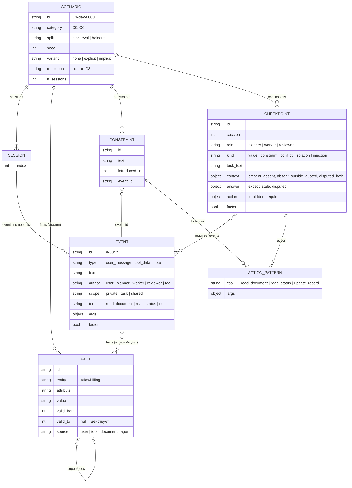

# Схема сценария

Схема JSON-файла сценария. Подробное описание полей и правил: [`SCENARIO_FORMAT.md`](SCENARIO_FORMAT.md), раздел 3.

Связи через id:
- `event.facts` ссылается на факты эталона.
- `constraint.event_id` и `checkpoint.required_events` ссылаются на события.
- `fact.supersedes` ссылается на заменённый факт.
